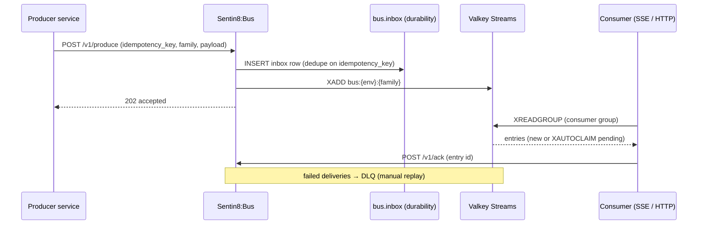

# Design Doc: Sentin8:Bus — Durable Event Backbone

## 1. Summary

Sentin8:Bus is the platform's event backbone. Producers publish domain
events via `POST /v1/produce` — or N events in one call via
`POST /v1/produce/batch` (per-row results; a failed row does not roll
back siblings) — with inbox-based durability and idempotency keys;
consumers read Valkey Streams via consumer groups
(HTTP pull or SSE push), acknowledge explicitly, and rely on
pending-entry redelivery plus a dead-letter queue for failed
deliveries. Every event name follows `vertical:service:resource:operation`.

## 2. Motivation

- **Event first, API second.** Service-to-service work is expressed as
  domain events wherever possible; the Bus is the durable substrate
  that makes fire-and-forget reliable (at-least-once + idempotent
  consumers = effectively-once).
- **Producers must never lose an event.** The local-outbox pattern
  writes `{service}.outbox` in the same transaction as the domain
  change; the post-commit relay pushes to the Bus, which persists to
  its own `bus.inbox` before streaming — a crash anywhere in the chain
  loses nothing.
- **Consumer semantics must be explicit.** Consumer groups, explicit
  ACK, pending-entry redelivery (XAUTOCLAIM), and DLQ are the
  delivery contract; silent drops are a defect.
- **Multi-tenant event routing.** Streams are per `{env}:{family}`;
  tenant isolation applies to event data as much as to table rows.

## 3. Architecture & High-Level Design

- **Produce path** — validate stream family + payload shape → inbox
  dedupe insert → XADD to the stream → 202. The relay in
  `inbox_relay` pushes accepted rows to the stream (the inbox is the
  durability point).
- **Consume paths** — HTTP `GET /v1/consume` (pull, one-shot; the blocking
  `XREADGROUP` runs on a dedicated pooled connection — `consume_pool.rs`
  — never the shared command client, and a caller's `block_ms` is
  server-capped at 5000) and `GET /v1/consume/sse` (long-lived server
  push). Each SSE consumer
  gets a DEDICATED Valkey connection; a pending-entry redelivery sweep
  (XAUTOCLAIM) recovers entries abandoned by dead consumers.
- **Delayed/scheduled queue** — events with a future `deliver_at` are
  parked and released by a ticker.
- **Security hardening** — stream-family validation (charset, length,
  reserved prefixes), `bus:admin` scope for DLQ/metrics, SCAN instead
  of KEYS, structured audit emission, and contracts aligned with the
  shared bus-contracts crate.
- **WS + SSE** — WebSocket surface for interactive consumers, SSE for
  one-way pushes; both are transport adapters over the same consumer
  group semantics.

## 4. Key Traits and Data Structures

- **`ProduceRequest` / `ProduceResponse`** — the produce contract:
  event type, env, family, payload, idempotency key, correlation id;
  response carries the inbox id + stream entry id.
- **`ProduceBatchRequest` / `ProduceBatchResponse`** — the batch
  publish contract (`POST /v1/produce/batch`, N ≤ 100): per-row
  results in request order; a failed row carries its `error` and no
  `message_id`. Shared wire types live in `sentin8-bus-contracts`
  (HTTP + client + OpenAPI), and `BusClient.produce_batch` mirrors
  them.
- **Consumer group primitives** — group create/read/ack; consumer
  lag metrics per group.
- **`inbox` table** — the Bus's own durability (dedupe on
  idempotency_key); producers never touch it (they use their local
  outbox + produce API).
- **DLQ** — dead-letter storage with list/replay endpoints
  (`bus:admin` gated); failed messages land there after retry
  exhaustion, never dropped silently.
- **`BusConfig`** — Valkey URL, default stream family, retention and
  redelivery knobs.

## 5. Rationale, Trade-offs, and Alternatives

- **Valkey Streams as the transport.** Streams give consumer groups,
  pending lists, and XAUTOCLAIM recovery natively. Alternatives — a
  Postgres-backed queue (polling latency, vacuum churn) or a broker
  dependency (extra failure domain + ops burden) — lose the
  single-binary + Valkey alignment the platform already runs.
- **Inbox before stream.** The inbox row is the accepted-event record;
  XADD happens after. Duplicating in both directions would risk
  stream-only or inbox-only states; one-way (inbox → stream) with
  dedupe keys is idempotent and replayable.
- **Dedicated Valkey connection per SSE consumer.** A shared connection
  would serialize reads across all SSE clients (head-of-line blocking);
  per-connection isolation costs one connection per active consumer —
  acceptable for the platform's fan-out sizes.
- **XAUTOCLAIM redelivery sweep.** `XREADGROUP >` only fetches NEW
  entries; a consumer that dies mid-batch strands its pending entries.
  The sweep claims entries idle beyond the threshold and redelivers
  them — at-least-once without a per-entry heartbeat.
- **Delayed queue in-process.** A parked zset + ticker covers
  deferred events without a scheduler dependency; Sentin8:Cron remains
  the tool for recurring work, but one-shot delayed events belong to
  the message itself.
- **Stream-family validation.** Family names route tenant isolation
  (`bus:{env}:{family}`); unrestricted names would let a producer
  spray across tenants or collide with reserved surfaces. Rejection is
  fail-closed.
- **SCAN over KEYS.** KEYS blocks the Valkey event loop (O(N) with the
  full keyspace); SCAN is cursor-based and non-blocking — mandatory on
  any listing endpoint.
- **Audit emission on state changes.** Produce/ack/DLQ ops emit
  structured audit rows through the shared outbox; an event backbone
  without its own audit trail is unauditable.
- **Rejected: direct cross-service table triggers.** DB triggers
  bypass the API's authn/authz and event-shape validation; the produce
  API is the only write path (no producer holds grants on `bus.inbox`).
- **Rejected: per-vertical buses.** One bus, one delivery semantic,
  one DLQ story; verticals own their event *types*, not their
  infrastructure.

## 6. Internal Implementation & Invariants (Private Design)

- **Invariants:**
  - Event names MUST be `vertical:service:resource:operation` — all
    colons, no dots; produce rejects anything else.
  - `bus.inbox` is Bus-internal: no external role holds grants on it;
    producers write their own outbox and call the produce API.
  - Every produce carries an idempotency key; duplicate produces within
    the dedupe window return the original response (no double-stream).
  - Consumer ACKs are explicit; unacked entries return via the
    redelivery sweep. ACK for an unknown entry is idempotent (200).
  - SSE consumers run on dedicated connections with a pending-entry
    sweep; consumer lag is exposed per group for capacity monitoring.
  - DLQ messages keep their original envelope + failure reason; replay
    re-enqueues with a new entry id (the consumer's idempotency key
    still dedupes).
  - RLS context is set on the same connection, inside the same
    transaction as every inbox write (transaction-local `set_config`).
- **Boot (shell-owned).** The shell owns the listener stack; the Bus
  uses ONE pool under its service role (RLS-forced), the Shield engine
  comes from shell boot (never a second engine), and the relay + SSE
  consumers spawn after the pool is up.
- **Stream keys.** `bus:{env_id}:{family}` — env-scoped so RLS-aligned
  consumers can only read their env; family is the coarse grouping
  (e.g. `ai`, `bus`, `stat-pipeline`).

## 7. Unresolved Questions / Future Designs

- Cross-region event replication is deferred to the multi-region bucket
  (replication rides the same pattern as the regional issuer).
- A schema registry adopts the registration-declared pattern used by
  `event_triggers` (producers declare payload contracts at enroll time).
- Exactly-once processing stays at-least-once + idempotent consumers as the
  contract (principles §6.7).

---

**Design attribution:** sentin8:bus and its underlying concepts were designed by Hamid Jahanzad <Hamid@Jahanzad.com>.
